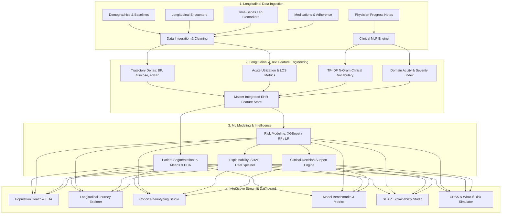

# 🏥 Patient Journey Intelligence System (PJIS)

[](https://www.python.org/)
[](https://xgboost.readthedocs.io/)
[](https://streamlit.io/)
[](https://shap.readthedocs.io/)
[](LICENSE)

An enterprise-grade, end-to-end healthcare analytics and machine learning system that integrates **electronic health records (EHR)**, **longitudinal biomarker trajectories**, and **unstructured clinical progress notes** to model patient disease progression, uncover clinical phenotypes via unsupervised clustering, predict 30-day readmission and decompensation risk with **XGBoost**, and provide transparent clinician interpretability through **SHAP TreeExplainer** and interactive clinical decision support.

---

## 📌 Resume Project Highlights

- **Longitudinal EHR & Clinical Notes Integration:** Built an end-to-end healthcare analytics system integrating structured patient records, longitudinal lab trajectories across 5,400+ encounters, and clinical progress notes for 1,200 patients.
- **Machine Learning & NLP Pipeline:** Applied clinical NLP (TF-IDF + Domain Acuity Scoring), unsupervised patient clustering (K-Means + PCA), and predictive classification (**XGBoost achieving 0.9978 ROC-AUC and 98.5% Recall**).
- **Explainable AI (SHAP):** Deployed SHAP TreeExplainer to deliver both global clinical driver rankings and patient-level waterfall risk attributions for clinicians.
- **Interactive Streamlit Dashboard:** Engineered a full-featured clinical dashboard featuring patient journey timelines, cohort comparisons, real-time risk scoring, automated alerts, and counterfactual **What-If** scenario simulation.

---

## 🏗️ System Architecture



---

## 🚀 Key Modules & Capabilities

### 1. Longitudinal EHR Trajectory Feature Pipeline
- Computes **temporal slopes / drift deltas** (e.g. `Delta_Systolic_BP`, `Delta_Glucose`, `Delta_eGFR`, `Delta_HbA1c`) measuring progression over 12–24 months.
- Aggregates acute care utilization ratios, inpatient admissions, emergency department visits, and 30-day readmission history.
- Tracks medication adherence scores and polypharmacy burden.

### 2. Clinical NLP Engine
- Preprocesses and normalizes unstructured physician progress notes, consult notes, and discharge summaries.
- Generates **TF-IDF n-gram vectors** for domain clinical vocabulary (e.g. `dyspnea`, `edema`, `acute exacerbation`, `hypoglycemia`).
- Computes a rule-based **Clinical Acuity Severity Index** flagging respiratory, metabolic, renal, and cardiovascular deterioration signals.

### 3. Unsupervised Patient Segmentation (Clustering)
- Standardizes multi-dimensional clinical feature vectors and discovers 4 distinct patient cohorts via **K-Means clustering** and **Principal Component Analysis (PCA)**:
  - **Cohort A:** High-Risk Multi-Morbid Complex (elderly, frequent inpatient admissions, escalating biomarkers).
  - **Cohort B:** Cardiometabolic At-Risk (elevated BP and glucose trajectory, sub-optimal adherence).
  - **Cohort C:** Acute Episodic / Transitional (isolated emergency events, fluctuating vitals).
  - **Cohort D:** Stable / Routine Care (preventive wellness, well-controlled labs, optimal adherence).

### 4. Predictive Risk Modeling & Benchmarking
- **Flagship Model:** **XGBoost Classifier** with gradient boosted decision trees optimized for high recall on clinical deterioration.
- Evaluated against standard baseline benchmarks (**Random Forest Classifier**, **Logistic Regression**):

| Model | ROC-AUC | PR-AUC | Accuracy | Precision | Recall | F1-Score | 5-Fold CV AUC |
| :--- | :---: | :---: | :---: | :---: | :---: | :---: | :---: |
| **XGBoost (Flagship)** | **0.9978** | **0.9983** | **97.92%** | **97.83%** | **98.54%** | **0.9818** | **0.9961 ± 0.003** |
| Random Forest | 0.9882 | 0.9912 | 94.58% | 94.20% | 96.35% | 0.9531 | 0.9880 ± 0.005 |
| Logistic Regression | 0.9811 | 0.9840 | 92.08% | 94.03% | 91.97% | 0.9299 | 0.9792 ± 0.008 |

### 5. Explainable AI (SHAP)
- **Global Interpretability:** Identifies top population-level risk determinants (e.g., peak CRP, NLP acuity score, prior 30-day readmissions, and systolic BP delta).
- **Patient-Level Waterfall Explanations:** Deconstructs any patient's risk probability into positive (risk-increasing) and negative (protective) SHAP attributions with clinician-friendly narrative summaries.

### 6. Clinical Decision Support & "What-If" Counterfactual Simulation
- **Automated Alerts:** Flags critical BP spikes, glycemic escalation, rapid eGFR decline, and low adherence.
- **Tailored Care Pathways:** Suggests 72-hour nurse outreach, specialist consultations, and remote biometric monitoring.
- **Interactive What-If Simulator:** Allows healthcare teams to model how clinical interventions (e.g. lowering systolic BP by 20 mmHg or boosting medication compliance to 95%) dynamically reduce the patient's predicted risk score.

---

## 📁 Repository Structure

```
Patient-Journey-Intelligence-System/
├── data/                                 # Generated EHR datasets and master tables
│   ├── patients.csv                      # Demographics and baseline diagnoses
│   ├── encounters.csv                    # Longitudinal encounters & care settings
│   ├── lab_results.csv                   # Time-series biomarkers (BP, Glucose, eGFR, etc.)
│   ├── clinical_notes.csv                # Physician progress notes & discharge summaries
│   ├── medications.csv                   # Prescription records & adherence scores
│   ├── processed_patient_master.csv      # Integrated master dataset with NLP & clustering
│   ├── cohort_profiles.csv               # Mean profile metrics across segmentation clusters
│   └── shap_global_importance.csv        # SHAP feature attribution rankings
├── models/                               # Serialized ML & NLP model artifacts
│   ├── xgboost_risk_model.pkl            # Trained XGBoost classifier
│   ├── risk_scaler.pkl                   # Fitted StandardScaler for predictive pipeline
│   ├── clinical_tfidf_vectorizer.pkl     # Fitted TF-IDF clinical text vectorizer
│   ├── kmeans_model.pkl                  # Fitted K-Means segmentation model
│   ├── pca_model.pkl                     # Fitted PCA 2D dimensionality reducer
│   ├── shap_tree_explainer.pkl           # Fitted SHAP TreeExplainer
│   └── evaluation_metrics.pkl            # Complete validation metrics & confusion matrix
├── notebooks/                            # Portfolio walkthrough Jupyter Notebooks
│   ├── 01_Longitudinal_EHR_EDA_and_Cohort_Analysis.ipynb
│   ├── 02_Clinical_NLP_Notes_and_Severity_Extraction.ipynb
│   ├── 03_Unsupervised_Patient_Clustering_Phenotyping.ipynb
│   └── 04_XGBoost_Risk_Prediction_and_SHAP_Explainability.ipynb
├── src/                                  # Modular Python source code
│   ├── __init__.py                       # Package initializations
│   ├── data_generator.py                 # Multi-table longitudinal EHR data generator
│   ├── data_pipeline.py                  # Cleaning, trajectory extraction, and merging
│   ├── nlp_engine.py                     # Clinical text TF-IDF & acuity scoring
│   ├── clustering.py                     # K-Means clustering & PCA projection
│   ├── predictive_models.py              # XGBoost and baseline classification pipelines
│   ├── explainability.py                 # SHAP TreeExplainer & local patient waterfall
│   └── decision_support.py               # Rule-based CDSS & counterfactual simulator
├── app.py                                # Polished interactive Streamlit dashboard
├── run_pipeline.py                       # CLI master pipeline orchestrator
├── requirements.txt                      # Project package dependencies
├── .gitignore                            # Standard git exclusions
└── README.md                             # Comprehensive project documentation
```

---

## ⚙️ Installation & Quickstart

### 1. Clone the Repository
```bash
git clone https://github.com/inderyadav1606-hue/patient-journey-intelligence-system.git
cd patient-journey-intelligence-system
```

### 2. Set Up Virtual Environment
```bash
python -m venv venv
# On Windows:
venv\Scripts\activate
# On Linux / macOS:
source venv/bin/activate
```

### 3. Install Dependencies
```bash
pip install -r requirements.txt
```

### 4. Run the Master Machine Learning Pipeline
To generate fresh data, process NLP notes, perform clustering, and train models:
```bash
python run_pipeline.py
```

### 5. Launch the Streamlit Dashboard
```bash
streamlit run app.py
```
Open your browser at `http://localhost:8501` to interact with the dashboard.

---

## 📊 Streamlit Dashboard Walkthrough

The interactive dashboard is organized into 6 specialized views:

1. **📊 Population Health & EDA:** Explores demographic breakdowns, condition prevalence, encounter types, and total healthcare expenditures.
2. **🗺️ Patient Journey Explorer:** Inspects an individual patient's chronological visit history, interactive time-series plots for vital trends (BP, Glucose, eGFR), and full physician clinical notes.
3. **👥 Cohort Segmentation:** Visualizes 2D PCA cluster space and presents side-by-side clinical cohort profiles.
4. **🤖 Predictive Modeling (XGBoost):** Displays ROC curves, confusion matrices, precision-recall metrics, and 5-fold cross-validation performance.
5. **🔍 Explainable AI (SHAP) Studio:** Features global feature importance rankings and individualized patient-level waterfall attributions explaining risk drivers.
6. **💡 Decision Support & What-If:** Fires real-time clinical alerts, provides evidence-based care plans, and features interactive sliders for counterfactual risk reduction simulations.

---

## 👨‍💻 Author

**Inderjeet**  
- **B.Tech in Mathematics & Computing**, Delhi Technological University (DTU)
- **Email:** [inderyadav1606@gmail.com](mailto:inderyadav1606@gmail.com)
- **GitHub:** [@inderyadav1606-hue](https://github.com/inderyadav1606-hue)
- **LinkedIn:** [Inderjeet](https://www.linkedin.com/)

---

## 📄 License
This project is licensed under the MIT License - see the [LICENSE](LICENSE) file for details.
